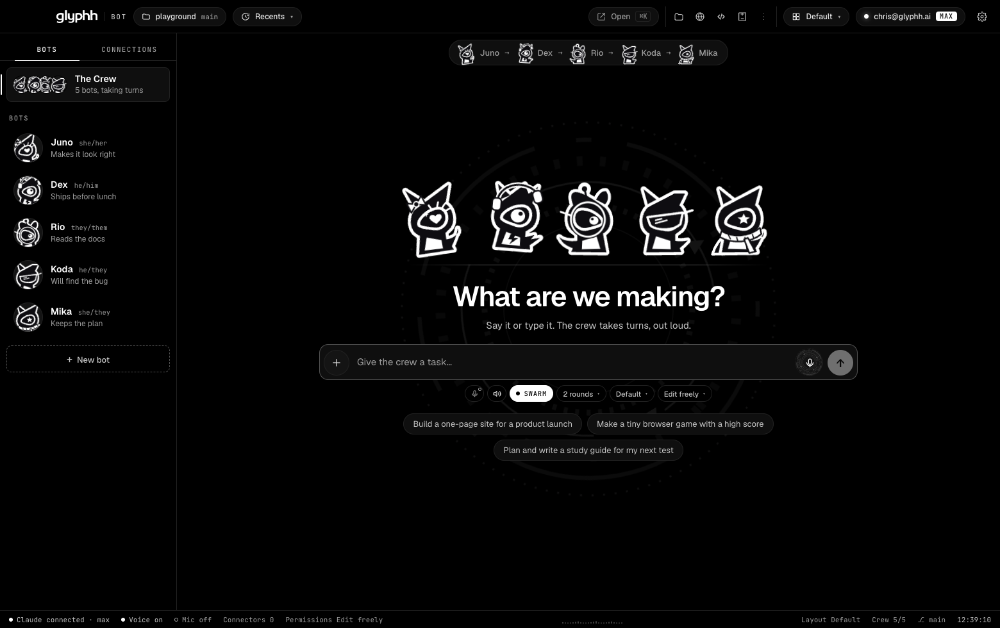
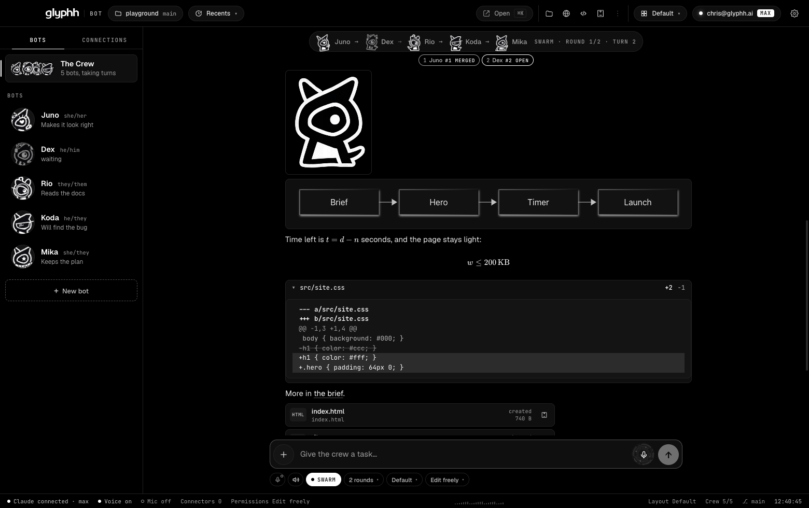
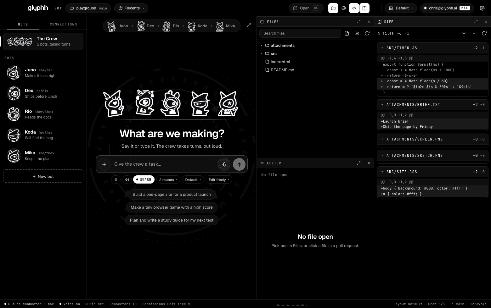
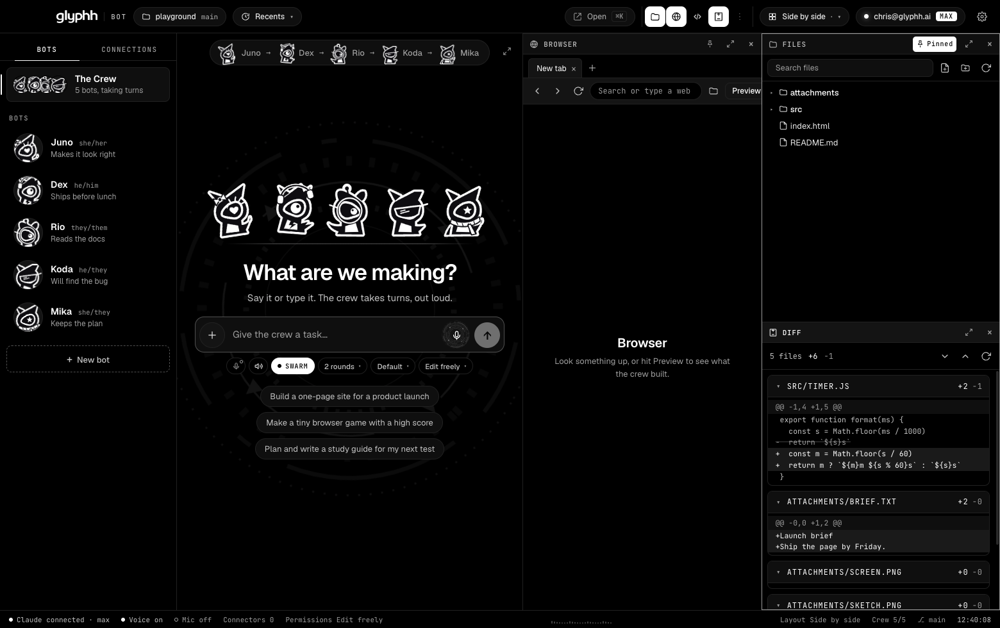
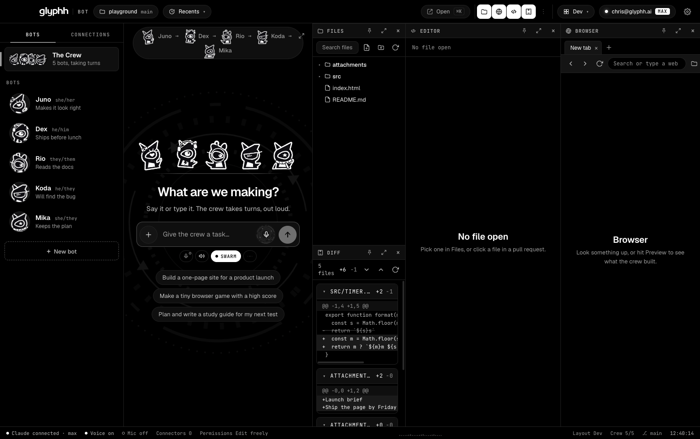
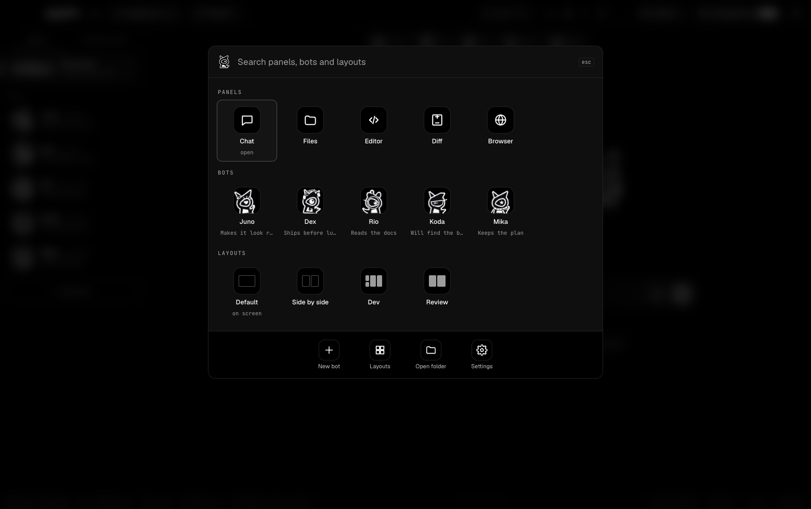
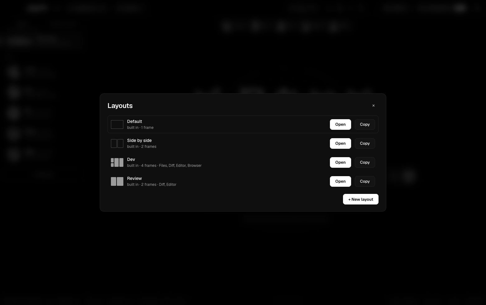

# Glyphh Bot

A desktop app for a crew of Claude bots. Each bot is Spike, the Glyphh cat, in its own look, voice, personality and job. They talk out loud, take turns and build things in a folder on your Mac. The chat is the center; panels (files, editor, diff, browser, a bot's own chat) open beside it only when you open them.



**Rich chat.** Full markdown with tables and task lists, highlighted code with Copy and Open in editor, inline images, diagrams, math and folding diffs. A bot's tool calls fold into one line, the files it made or changed show as cards that open in the Editor, and each crew turn's pull request is a card you merge or reject right there. Attach files with +, by dropping them on the chat or by pasting: they are copied into the folder, and images go to the bot as pictures.




**Panels stack the way Claude's do.** The first opens full height beside the chat, the second under it, the third as a new column, the fourth under that. Close one and the rest reflow; close the last and the chat has the whole width. Each panel can be expanded over the desk and closed from its header; opening one that is already open just focuses it.




**Layouts and pins.** A layout sets the frames and their sizes; a pinned frame takes every new panel. Empty frames are never drawn.





**Recents.** Past chats, pinned ones first and the rest by folder. Each row pins, archives or deletes; archived chats wait in the Archived view.


**Connections.** Your Claude account and its connectors, with each service's own icon. Add opens Claude's connector settings in the app's browser.


**Account.** The button at the foot of the left rail opens upward: the account, Settings, Switch account and Log out.


**Open anything (⌘K)** and the layout manager:






## Run it

```bash
npm install
npm start
```

- **Claude**: the app uses your own Claude Code login (`claude auth login`). It asks you to connect if you are not signed in, and the Connections tab shows the account and its connectors.
- **Voice**: bots speak and listen through ElevenLabs. Put your key in Settings (on Chris's Mac it falls back to the key in `glyphh/server/.env`).
- **Bots**: left rail. Click one to talk to it in the chat, or open its own chat as a panel from the top bar's ⋮ menu or ⌘K.
- **The Crew**: the main chat. With Swarm on, each bot takes a turn on its own git branch and opens a pull request; the strip on top shows whose turn it is and how each turn's PR went. With it off they just talk it over.
- **Top bar**: Recents, ⌘K, the Files, Browser, Editor and Diff buttons (click again to close), ⋮ for the other panels and the bots, and the layout menu (switch, save, layout manager).
- Projects live in `~/Glyphh Bot/`. Bots, layouts, recent chats, settings and your key are stored in `~/Library/Application Support/Glyphh Bot/glyphh-bot.json`, never in this repo. Attached files go into the project's `attachments/`.

## Check it

```bash
npm run typecheck
npm test
npm run build
GLYPHH_BOT_SHOT=/tmp/main.png npx electron .
```

`GLYPHH_BOT_SHOT` saves a picture of the window and quits. `GLYPHH_BOT_SHOT_JS` runs in the page first, with the store on `window.__shot` to set up a scene (for example `window.__shot.openPanel('files')`); `GLYPHH_BOT_SHOT_WAIT` and `GLYPHH_BOT_SHOT_AFTER` are the waits in milliseconds. `GLYPHH_BOT_DATA` and `GLYPHH_BOT_HOME` point the data file and the projects folder somewhere else, so a screenshot run never touches your own.

## Code

- `src/main`: Claude, voice, git, the workspace and its files (`files.ts`), connector icons (`icons.ts`), the data file.
- `src/shared/layouts.ts`: frames, the panel stack and the desk's geometry. `recents.ts`: past chats. `connectors.ts`: which service a connector is. Pure data, tested in `test/`.
- `src/renderer/src`: the UI. `Chat.tsx` the chat and composer, `md.ts` markdown, `Desk.tsx` the desk, `CommandCenter.tsx` the ⌘K sheet, `LayoutManager.tsx` the layout editor, `panels/` the panels, `engine.ts` runs the turns, `catArt.ts` draws the cats.

Ported from: the cat from Glyphh OS (`os/src/renderer/character.js`), the command center from Glyphh OS's Apps sheet, the layout grid from the Glyphh desktop (`app/src/renderer/help/workspace-grid.ts`), and the Files, Editor, Diff and Browser panels from the desktop's code workbench and `working-directory.ts`.
