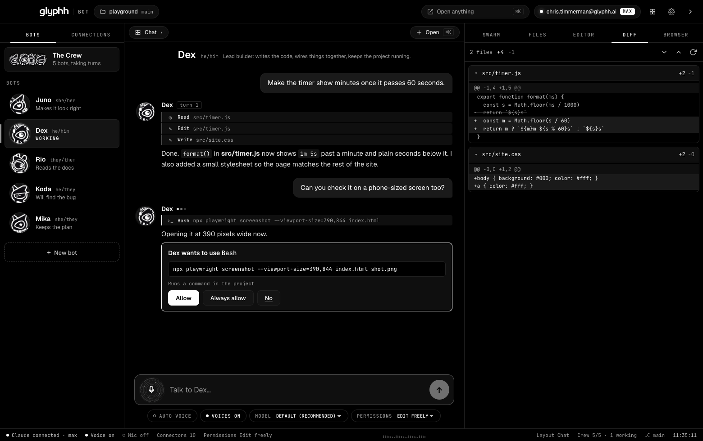
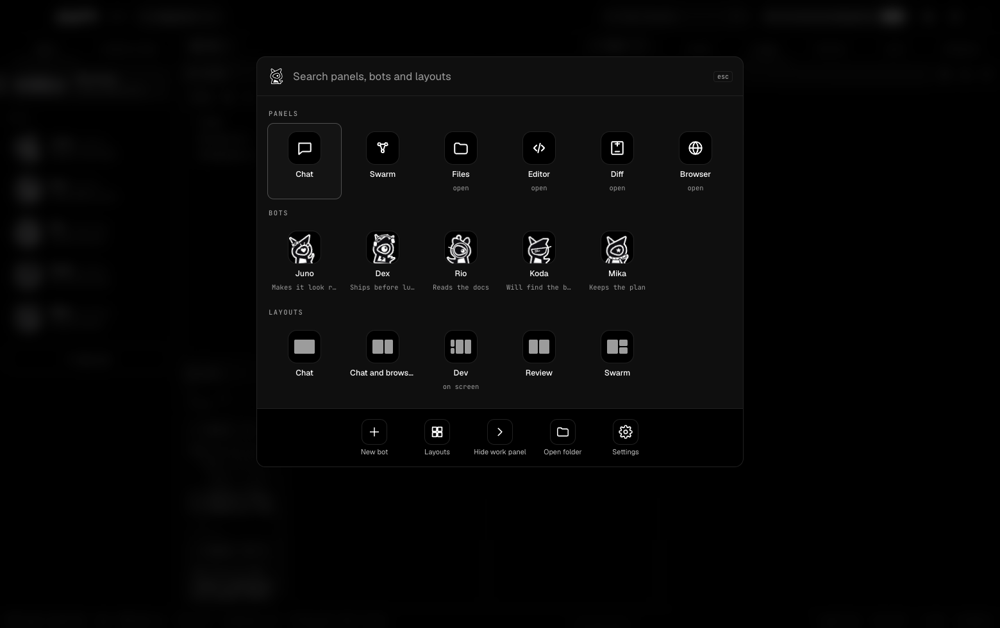
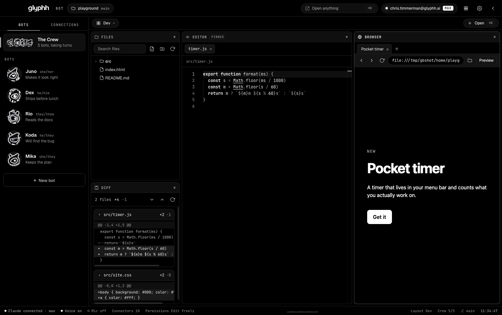
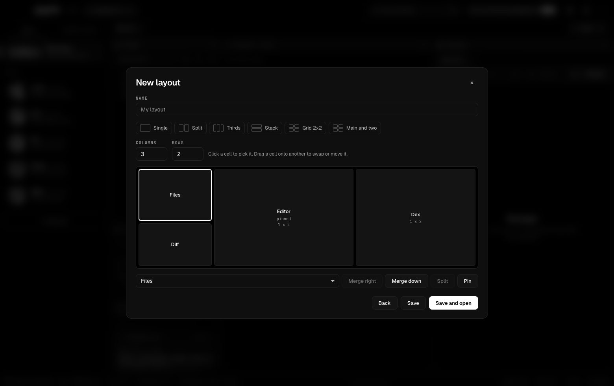
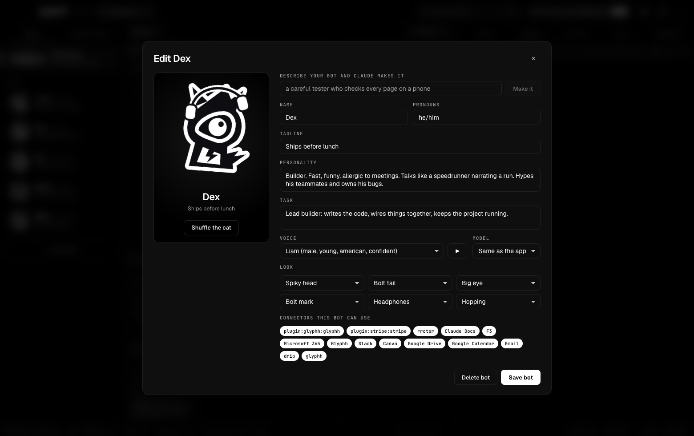

# Glyphh Bot

A desktop app for a crew of Claude bots. Each bot is Spike, the Glyphh cat, in its own look, voice, personality and job. They talk out loud, take turns and build things in a folder on your Mac, and you lay out the panels you work in yourself: chat, files, editor, diff, browser and swarm.


**One bot at work.** Tool calls, a permission question and the working-tree diff:



**Open anything (⌘K).** Panels, bots and layouts as icons, with one search. A tile opens in the layout on screen, or drag it onto a cell:



**Layouts.** The Dev layout: files, diff, the Monaco editor and the browser.



**Your own layouts.** Pick a shape or set columns and rows, merge, split, pin the cell new panels reuse, put a panel or a bot in each cell, name it and save it:





## Run it

```bash
npm install
npm start
```

- **Claude**: the app uses your own Claude Code login (`claude auth login`). It asks you to connect if you are not signed in, and the Connections tab shows the account and its connectors.
- **Voice**: bots speak and listen through ElevenLabs. Put your key in Settings (on Chris's Mac it falls back to the key in `glyphh/server/.env`).
- **Bots**: left rail. Click one to talk to it in the Chat panel, or press `panel` to give it its own cell in the layout.
- **The Crew**: the main chat. With Swarm on, each bot takes a turn on its own git branch and opens a pull request; with it off they just talk it over.
- **Layouts**: the bar above the desk switches layouts, saves the one on screen and opens the layout manager. Drag a cell's header onto another cell (the middle swaps, an edge moves it), drag the seams to resize, double-click a seam to even it out. The layout on screen comes back when you reopen the app.
- **Work panel**: the right rail keeps Swarm, Files, Editor, Diff and Browser as tabs, for layouts that don't hold them.
- Projects live in `~/Glyphh Bot/`. Bots, layouts, settings and your key are stored in `~/Library/Application Support/Glyphh Bot/glyphh-bot.json`, never in this repo.

## Check it

```bash
npm run typecheck
npm test
npm run build
GLYPHH_BOT_SHOT=/tmp/main.png npx electron .
```

`GLYPHH_BOT_SHOT` saves a picture of the window and quits. `GLYPHH_BOT_SHOT_JS` runs in the page first, with the store on `window.__shot` to set up a scene (for example `window.__shot.set({commandOpen:true})`); `GLYPHH_BOT_SHOT_WAIT` and `GLYPHH_BOT_SHOT_AFTER` are the waits in milliseconds. `GLYPHH_BOT_DATA` and `GLYPHH_BOT_HOME` point the data file and the projects folder somewhere else, so a screenshot run never touches your own.

## Code

- `src/main`: Claude, voice, git, the workspace and its files (`files.ts`), the data file.
- `src/shared/layouts.ts`: layout grids, saving and loading, where an opened panel goes. Pure data, tested in `test/layouts.test.ts`.
- `src/renderer/src`: the UI. `catArt.ts` draws the cats, `Desk.tsx` the layout on screen, `CommandCenter.tsx` the ⌘K sheet, `LayoutManager.tsx` the layout editor, `panels/` the panels, `engine.ts` runs the turns.

Ported from: the cat from Glyphh OS (`os/src/renderer/character.js`), the command center from Glyphh OS's Apps sheet, the layout grid from the Glyphh desktop (`app/src/renderer/help/workspace-grid.ts`), and the Files, Editor, Diff and Browser panels from the desktop's code workbench and `working-directory.ts`.
